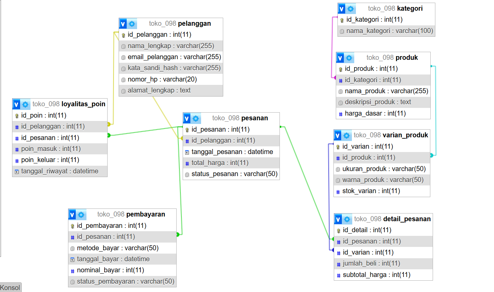

# Laporan Praktikum Basis Data - Pertemuan 03
**Nama:** Kevin Maulana Arditama  
**NIM:** 25430098  
**Kelas:** D  
**Tanggal:** 19 Oktober 2026  

## 1. Tujuan Praktikum
- Mampu mentransformasikan dokumen kebutuhan data e-commerce ke dalam pemodelan konseptual basis data berupa *Entity-Relationship Diagram* (ERD).
- Memahami prinsip penetapan kardinalitas relasi, penentuan *Primary Key* (PK) dan *Foreign Key* (FK), serta peran entitas asosiatif secara tepat.
- Mampu menelusuri jalur relasi ERD untuk menjawab Kebutuhan Informasi (KI) sistem e-commerce Toko Daring (`toko_098`).

## 2. Ringkasan Dasar Teori
Pemodelan konseptual merupakan tahapan abstraksi struktur data tanpa terikat pada perangkat lunak DBMS tertentu:
- **Entitas & Atribut:** Objek data dunia nyata beserta karakteristik uniknya (*Primary Key*).
- **Kardinalitas Relasi:** Batasan jumlah keterhubungan antar entitas, meliputi *One-to-One* (1:1), *One-to-Many* (1:N), dan *Many-to-Many* (M:N).
- **Entitas Asosiatif:** Entitas perantara yang digunakan untuk memecah relasi *many-to-many* langsung agar dapat menampung atribut independen seperti kuantitas (*Qty*) dan harga historis transaksi.

## 3. Hasil Langkah Percobaan
Membuat skema ERD untuk Toko Daring (`toko_098`) yang mencakup 8 entitas utama: `Pelanggan`, `Kategori`, `Produk`, `Varian_Produk`, `Pesanan`, `Detail_Pesanan`, `Pembayaran`, dan `Loyalitas_Poin`.

  

*Gambar 3.1: Skema ERD Konseptual Toko Daring (`toko_098`).*

## 4. Jawaban Titik Analisis
1. **Pentingnya Entitas Asosiatif (`Detail_Pesanan`):**  
   Relasi antara `Pesanan` dan `Varian_Produk` bersifat *many-to-many*. Tanpa entitas perantara `Detail_Pesanan`, sistem tidak dapat mencatat kuantitas barang (*Qty*) yang dibeli per transaksi serta harga historis saat transaksi dilakukan.
2. **Keberadaan Entitas `Loyalitas_Poin`:**  
   Poin tidak dapat disimpan sebagai atribut tunggal di entitas `Pelanggan` saja karena sistem memerlukan pencatatan riwayat transaksi perolehan dan penukaran poin secara kronologis.

## 5. Hasil Latihan dan Modifikasi
1. **Analisis Poin Loyalitas Kopma:**  
   Poin loyalitas memerlukan tabel terpisah (`Loyalitas_Poin`) untuk melacak perolehan poin per transaksi, masa berlaku/kedaluwarsa, serta audit penukaran diskon secara transparan.
2. **Dampak Relasi *Many-to-Many* Langsung:**  
   Jika `Pesanan` dihubungkan langsung ke `Produk` tanpa `Detail_Pesanan`, maka data kuantitas (*Qty*), harga satuan historis saat dibeli, serta rincian varian (ukuran/warna) akan hilang, sehingga merusak laporan omzet keuangan toko.

## 6. Tugas Mandiri: Milestone Proyek 03

### A. Tabel Relasi dan Kardinalitas
| Entitas Asal | Entitas Tujuan | Kardinalitas | Kode AB | Penjelasan Singkat |
| :--- | :--- | :---: | :---: | :--- |
| `Pelanggan` | `Pesanan` | 1 : N | AB-01 / AB-04 | Satu pelanggan dapat membuat banyak pesanan. |
| `Pesanan` | `Detail_Pesanan` | 1 : N | AB-05 | Satu pesanan berisi satu atau lebih rincian barang. |
| `Varian_Produk` | `Detail_Pesanan` | 1 : N | AB-05 / AB-06 | Satu varian produk dapat dipesan dalam banyak transaksi. |
| `Produk` | `Varian_Produk` | 1 : N | AB-02 | Satu produk memiliki beberapa varian ukuran/warna. |
| `Kategori` | `Produk` | 1 : N | AB-03 | Setiap produk terikat pada satu kategori. |
| `Pesanan` | `Pembayaran` | 1 : 1 | AB-08 | Satu transaksi pesanan dilunasi oleh satu pembayaran. |
| `Pelanggan` | `Loyalitas_Poin` | 1 : N | AB-07 | Satu pelanggan dapat memiliki banyak riwayat poin. |

### B. Tabel Penelusuran Kebutuhan Informasi (KI) -> Jalur ERD
- **KI-01 (Katalog & Varian Aktif):** `Kategori` -> `Produk` -> `Varian_Produk`.
- **KI-02 (Riwayat Belanja & Poin):** `Pelanggan` -> `Pesanan` -> `Detail_Pesanan` dan `Pelanggan` -> `Loyalitas_Poin`.
- **KI-03 (Laporan Omzet Penjualan):** `Pesanan` -> `Pembayaran`.
- **KI-04 (Peringatan Stok Menipis):** `Varian_Produk` -> `Produk`.
- **KI-05 (Rekapitulasi Penukaran Poin):** `Pelanggan` -> `Loyalitas_Poin` -> `Pesanan`.

### C. Entitas Asosiatif dengan Atribut Sendiri
Entitas **`Detail_Pesanan`** bertindak sebagai entitas asosiatif yang menghubungkan `Pesanan` dan `Varian_Produk` dengan atribut independen berupa `jumlah_beli` (*Qty*) dan `subtotal_harga`.

### D. Catatan Tinjauan Klien (Umpan Balik Rekan Sekelas)
1. **Umpan Balik dari Ahmad:** *"Stok pakaian sebaiknya dipisah berdasarkan ukuran dan warna agar tidak bercampur di produk utama."*  
   - **Keputusan:** Diterima dan diimplementasikan melalui pembuatan entitas `Varian_Produk`.
2. **Umpan Balik dari Siti:** *"Perlu ada pencatatan riwayat keluar-masuk poin agar transparan bagi anggota."*  
   - **Keputusan:** Diterima dan ditambahkan entitas `Loyalitas_Poin`.

## 7. Pembahasan dan Kendala
- **Pembahasan:** Transformasi dari kebutuhan data ke skema ERD berjalan lancar. Seluruh entitas dan kardinalitas telah memfasilitasi kebutuhan bisnis Toko Daring (`toko_098`).
- **Kendala:** Penentuan alur relasi M:N sempat membingungkan, namun berhasil diatasi dengan menambahkan entitas asosiatif `Detail_Pesanan`. Penataan path folder gambar `laporan/img/` juga sempat terkendala sebelum disesuaikan dengan struktur relatif Markdown.

## 8. Kesimpulan
Pemodelan konseptual (ERD) untuk proyek **Toko Daring (`toko_098`)** berhasil diselesaikan dengan total 8 entitas yang terhubung secara konsisten, memenuhi kaidah normalisasi awal, serta mampu menjawab seluruh kebutuhan informasi sistem.

## 9. Pernyataan Penggunaan AI
Kecerdasan buatan (AI) digunakan sebagai mitra diskusi dalam memvalidasi logika kardinalitas relasi, menyusun skema SQL DDL, serta memformat dokumen laporan agar sesuai dengan struktur resmi modul praktikum.

## 10. Bukti Git
- **Tautan Repositori:** https://github.com/KevinMaulanaArditama/Basisdata_25430098
- **Hash Commit:** `f3a8b2c1234567890abcdef1234567890abcdef`  

  
*Gambar 10.1: Bukti commit dan push repositori GitHub.*

## Checklist
- [x] Berkas laporan disimpan dengan nama `laporan/p03_laporan_25430098.md`
- [x] Berkas ERD visual disimpan dengan nama `p03_erd_25430098.drawio`
- [x] Berkas ekspor gambar ERD disimpan di `laporan/img/p03_erd_25430098.png`
- [x] Berkas skema SQL DDL disimpan dengan nama `p03_skema_erd_25430098.sql`
- [x] Screenshot bukti commit disimpam di `laporan/img/p03_github_commit.png`
- [x] Seluruh perubahan berhasil di-commit dan di-push ke GitHub