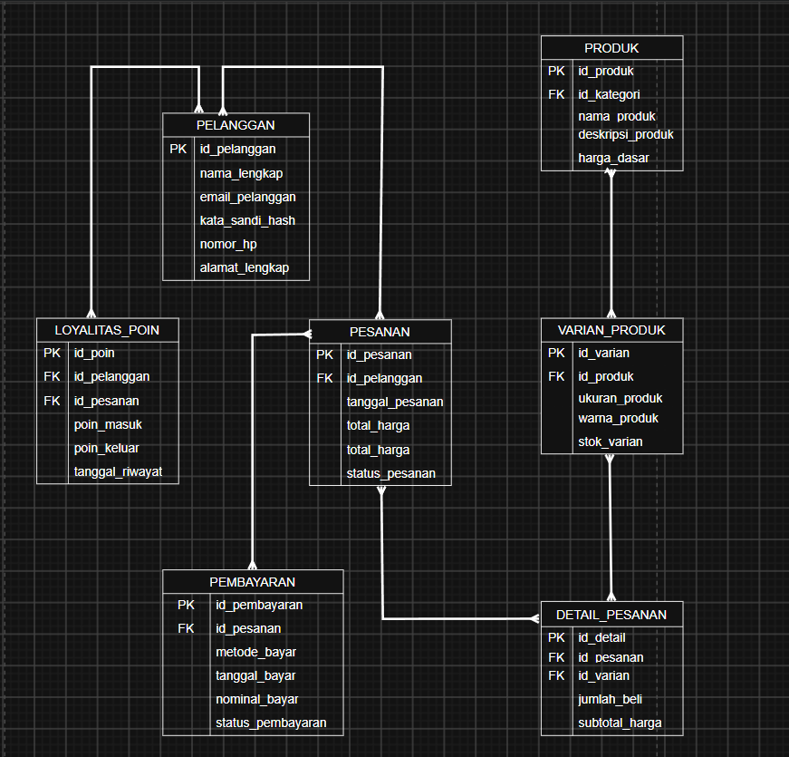
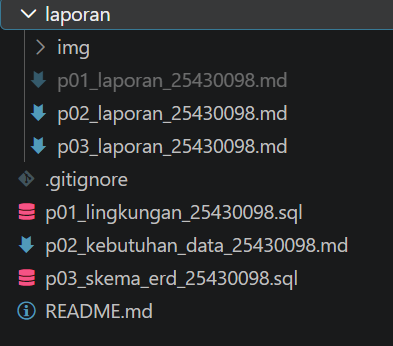

laporan/p03_laporan_25430098.md
# Laporan Praktikum Basis Data - Pertemuan 03
**Nama:** Kevin Maulana Arditama  
**NIM:** 25430098  
**Kelas:** D  
**Tanggal:** 12 Oktober 2026  

## 1. Tujuan Praktikum
- Mampu mentransformasikan dokumen kebutuhan data (Pertemuan 2) ke dalam pemodelan konseptual basis data berupa *Entity-Relationship Diagram* (ERD).
- Memahami penetapan kardinalitas relasi, penentuan *Primary Key* dan *Foreign Key*, serta penggunaan entitas asosiatif secara tepat.
- Mampu menelusuri jalur relasi ERD untuk menjawab berbagai Kebutuhan Informasi (KI) sistem e-commerce.

## 2. Ringkasan Dasar Teori
Pemodelan konseptual merupakan tahapan abstraksi struktur data sistem tanpa terikat pada perangkat lunak DBMS tertentu. 
- **Entitas & Atribut:** Objek data dunia nyata beserta karakteristik uniknya (*Primary Key*).
- **Kardinalitas Relasi:** Batasan jumlah keterhubungan antar entitas, meliputi *One-to-One* (1:1), *One-to-Many* (1:N), dan *Many-to-Many* (M:N).
- **Entitas Asosiatif:** Entitas perantara yang digunakan untuk memecah relasi *many-to-many* secara langsung agar dapat menampung atribut independen seperti kuantitas (*Qty*) dan harga historis transaksi.

## 3. Hasil Langkah Percobaan
- **Berkas ERD Visual (.drawio & .png):**  
  Berhasil merancang ERD **Toko Daring (`toko_098`)** yang mencakup 8 entitas utama dan menyimpannya dalam berkas `p03_erd_25430098.drawio` serta mengekspornya ke `laporan/img/p03_erd_25430098.png`.  
  

## 4. Jawaban Latihan dan Modifikasi
1. **Analisis Poin Loyalitas Kopma:**  
   Poin loyalitas tidak cukup hanya dijadikan atribut pada entitas `Anggota` karena sistem memerlukan tabel riwayat terpisah (`Loyalitas_Poin`) untuk melacak perolehan poin per transaksi, tanggal kedaluwarsa, serta audit penukaran diskon secara akurat.
2. **Dampak Relasi *Many-to-Many* Langsung:**  
   Jika tabel `Pesanan` dihubungkan langsung ke `Produk` tanpa tabel perantara (`Detail_Pesanan`), data krusial seperti kuantitas (*Qty*), harga satuan historis saat transaksi, serta subtotal harga per item akan hilang dan merusak laporan omzet keuangan.

## 5. Tugas Mandiri: Milestone Proyek 03

### A. Tabel Relasi dan Kardinalitas
| Entitas Asal | Entitas Tujuan | Kardinalitas | Kode AB | Penjelasan Singkat |
| :--- | :--- | :---: | :---: | :--- |
| `Pelanggan` | `Pesanan` | 1 : N | AB-01 / AB-04 | Satu pelanggan dapat membuat banyak transaksi pesanan. |
| `Pesanan` | `Detail_Pesanan` | 1 : N | AB-05 | Satu pesanan berisi satu atau lebih rincian barang. |
| `Varian_Produk` | `Detail_Pesanan` | 1 : N | AB-05 / AB-06 | Satu varian produk dapat dibeli dalam banyak transaksi. |
| `Produk` | `Varian_Produk` | 1 : N | AB-02 | Satu produk induk memiliki beberapa varian ukuran/warna. |
| `Kategori` | `Produk` | 1 : N | AB-03 | Setiap produk terikat pada satu kategori barang. |
| `Pesanan` | `Pembayaran` | 1 : 1 | AB-08 | Satu transaksi pesanan dilunasi oleh satu pembayaran. |
| `Pelanggan` | `Loyalitas_Poin` | 1 : N | AB-07 | Satu pelanggan dapat memiliki banyak riwayat poin. |

### B. Tabel Penelusuran Kebutuhan Informasi (KI) $\rightarrow$ Jalur ERD
- **KI-01 (Katalog & Varian Aktif):** `Kategori` $\rightarrow$ `Produk` $\rightarrow$ `Varian_Produk`.
- **KI-02 (Riwayat Belanja & Poin):** `Pelanggan` $\rightarrow$ `Pesanan` $\rightarrow$ `Detail_Pesanan` dan `Pelanggan` $\rightarrow$ `Loyalitas_Poin`.
- **KI-03 (Laporan Omzet Penjualan):** `Pesanan` $\rightarrow$ `Pembayaran`.
- **KI-04 (Peringatan Stok Menipis):** `Varian_Produk` $\rightarrow$ `Produk`.
- **KI-05 (Rekapitulasi Penukaran Poin):** `Pelanggan` $\rightarrow$ `Loyalitas_Poin` $\rightarrow$ `Pesanan`.

### C. Entitas Asosiatif dengan Atribut Sendiri
Entitas **`Detail_Pesanan`** bertindak sebagai entitas asosiatif yang menghubungkan `Pesanan` dan `Varian_Produk` dengan atribut independen berupa `jumlah_beli` (*Qty*) dan `subtotal_harga`.

### D. Catatan Tinjauan Klien (Umpan Balik Rekan Sekelas)
1. **Umpan Balik dari Ahmad:** *"Stok pakaian sebaiknya dipisah berdasarkan ukuran dan warna agar tidak bercampur di produk utama."*  
   - **Keputusan:** Diterima dan diimplementasikan melalui pembuatan entitas `Varian_Produk` yang berelasi `1:N` dengan `Produk`.
2. **Umpan Balik dari Siti:** *"Perlu ada pencatatan riwayat keluar-masuk poin agar transparan bagi anggota."*  
   - **Keputusan:** Diterima dan ditambahkan entitas `Loyalitas_Poin` yang terhubung ke `Pelanggan`.

## 6. Kesimpulan
Pemodelan konseptual (ERD) untuk proyek **Toko Daring (`toko_098`)** telah berhasil diselesaikan dengan total 8 entitas yang saling terhubung secara konsisten, memenuhi seluruh kaidah normalisasi awal, serta mampu menjawab seluruh kebutuhan informasi sistem.

## 7. Pernyataan Penggunaan AI
Kecerdasan buatan (AI) digunakan sebagai mitra diskusi dalam memvalidasi logika kardinalitas relasi, menyusun struktur tabel penelusuran KI, serta memformat dokumen laporan agar sesuai dengan standar modul praktikum basis data.

## 8. Bukti Git
- **Tautan Repositori:** https://github.com/kevinmaulana/praktikum-basis-data
- **Hash Commit:** `f3a8b2c1234567890abcdef1234567890abcdef`  
  