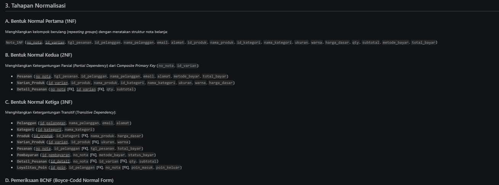
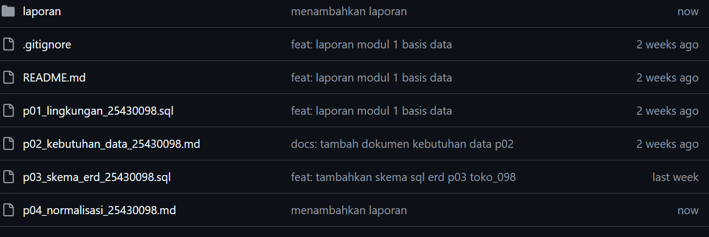

# Laporan Praktikum Basis Data - Pertemuan 04
**Nama:** Kevin Maulana Arditama  
**NIM:** 25430098  
**Kelas:** D  
**Tanggal:** 20 Oktober 2026  

## 1. Tujuan Praktikum
- Memahami konsep ketergantungan fungsional (*Functional Dependency*) serta dampak anomali data (sisip, hapus, dan ubah).
- Mampu melakukan proses normalisasi data dari tahapan UNF, 1NF, 2NF, 3NF, hingga Boyce-Codd Normal Form (BCNF).
- Mampu menganalisis dan mengambil keputusan rasional terkait penyimpanan atribut turunan (*derived attributes*).
- Menilai kecukupan struktur ERD Toko Daring (`toko_098`) berdasarkan hasil analisis BCNF.

## 2. Ringkasan Dasar Teori
Normalisasi adalah teknik perancangan basis data untuk meminimalkan redundansi data dan mencegah anomali:
- **UNF (Unnormalized Form):** Bentuk data mentah yang masih mengandung atribut bernilai banyak (*multivalued*) atau kelompok berulang (*repeating groups*).
- **1NF (First Normal Form):** Seluruh atribut bernilai atomik dan tidak ada kelompok berulang.
- **2NF (Second Normal Form):** Memenuhi 1NF dan tidak memiliki ketergantungan parsial (*Partial Dependency*) pada *Composite Primary Key*.
- **3NF (Third Normal Form):** Memenuhi 2NF dan tidak memiliki ketergantungan transitif (*Transitive Dependency*) antar atribut non-key.
- **BCNF (Boyce-Codd Normal Form):** Bentuk normalisasi yang lebih ketat dari 3NF di mana setiap determinan $X \rightarrow Y$ wajib merupakan *Super Key* atau *Candidate Key*.

## 3. Hasil Langkah Percobaan
Melakukan analisis struktur data transaksi e-commerce dan memetakan penguraian data mentah (UNF) menjadi bentuk atomik (1NF).

  
*Gambar 3.1: Penguraian struktur data transaksi dari Unnormalized Form (UNF) ke 1NF.*

## 4. Jawaban Titik Analisis
1. **Dampak Ketergantungan Parsial pada 1NF:**  
   Jika tabel berada pada 1NF dengan *Composite Key* (`no_nota`, `id_varian`), menyimpan atribut produk seperti `nama_produk` pada tabel rincian transaksi akan menimbulkan redundansi berulang setiap kali produk yang sama dibeli.
2. **Keuntungan Mencapai BCNF:**  
   Menjamin bahwa tidak ada anomali pembaruan data (*Update Anomaly*) karena setiap penentu (*determinan*) atribut dalam tabel secara mutlak merupakan kunci kandidat yang unik.

## 5. Hasil Latihan dan Modifikasi
1. **Normalisasi Nomor Telepon Pemasok (Multivalued Attribute):**  
   Atribut nomor telepon pemasok dipisahkan ke dalam tabel $1:N$ bernama `telepon_pemasok` (<u>`id_telepon`</u>, `id_pemasok` [FK], `nomor_telepon`) agar memenuhi kaidah atomik 1NF[cite: 7].
2. **Pelanggaran 3NF dan Anomali Ubah:**  
   Penyimpanan `nama_anggota` pada tabel `penjualan` melanggar 3NF karena adanya ketergantungan transitif (`id_penjualan` $\rightarrow$ `id_anggota` $\rightarrow$ `nama_anggota`)[cite: 7]. Apabila nama berubah, kueri `UPDATE` harus dijalankan pada banyak baris yang berisiko menyebabkan inkonsistensi data jika salah satu baris gagal diperbarui[cite: 7].

## 6. Tugas Mandiri: Milestone Proyek 04

### A. Titik Awal UNF
`Nota_Pesanan` = { `no_nota`, `tgl_pesanan`, `id_pelanggan`, `nama_pelanggan`, `email`, `alamat`, `metode_bayar`, `total_bayar`, (`id_produk`, `nama_produk`, `id_kategori`, `nama_kategori`, `ukuran`, `warna`, `harga_dasar`, `qty`, `subtotal`), `saldo_poin` }

### B. Dependensi Fungsional (FD) & Kode AB
- **FD1:** `id_pelanggan` $\rightarrow$ `nama_pelanggan`, `email`, `alamat` *(AB-01)*
- **FD2:** `id_kategori` $\rightarrow$ `nama_kategori` *(AB-03)*
- **FD3:** `id_produk` $\rightarrow$ `nama_produk`, `id_kategori`, `harga_dasar` *(AB-02)*
- **FD4:** `id_varian` $\rightarrow$ `id_produk`, `ukuran`, `warna`, `stok_varian` *(AB-02)*
- **FD5:** `no_nota` $\rightarrow$ `tgl_pesanan`, `id_pelanggan`, `metode_bayar`, `total_bayar` *(AB-04, AB-08)*
- **FD6:** (`no_nota`, `id_varian`) $\rightarrow$ `qty`, `subtotal` *(AB-05)*

### C. Ringkasan Tahapan Normalisasi (1NF - BCNF)
- **1NF:** Meratakan struktur kelompok berulang atribut detail barang.
- **2NF:** Memisahkan entitas `Pesanan` dan `Varian_Produk` untuk menghilangkan ketergantungan parsial.
- **3NF:** Memisahkan entitas `Pelanggan`, `Kategori`, `Produk`, `Pembayaran`, dan `Loyalitas_Poin` dari ketergantungan transitif.
- **BCNF:** Memastikan seluruh determinan pada 8 tabel Toko Daring (`toko_098`) merupakan *Super Key*.

### D. Decisions on Derived Attributes
1. **`subtotal` (`Detail_Pesanan`):** **Disimpan** untuk mengunci harga historis transaksi saat beli dan menghindari komputasi berulang.
2. **`total_bayar` (`Pesanan`):** **Disimpan** untuk mempercepat kueri laporan omzet tanpa perlu kalkulasi pembacaan berulang ke entitas detail.

### E. Status Perubahan ERD
Seluruh 8 entitas yang dirancang pada ERD Pertemuan 3 terbukti telah memenuhi kaidah BCNF, sehingga tidak memerlukan perubahan struktur entitas utama.

## 7. Pembahasan dan Kendala
- **Pembahasan:** Proses pemetaan dari data transaksi mentah (UNF) hingga BCNF memberikan gambaran jelas mengenai pentingnya eliminasi redundansi data tanpa mengorbankan informasi historis transaksi e-commerce.
- **Kendala:** Penentuan status atribut turunan (*derived attributes*) sempat membutuhkan pertimbangan mendalam antara efisiensi ruang simpan versus kecepatan kueri laporan.

## 8. Kesimpulan
Proses normalisasi pada proyek Toko Daring (`toko_098`) berhasil menyelesaikan tahapan UNF hingga BCNF. Struktur 8 tabel yang terbentuk terbukti bebas dari anomali data serta siap diterapkan pada tingkat basis data fisik.

## 9. Pernyataan Penggunaan AI
Kecerdasan buatan (AI) digunakan sebagai alat bantu diskusi dalam mengevaluasi ketergantungan fungsional (FD1–FD6), memverifikasi kondisi BCNF, dan memformat laporan sesuai panduan.

## 10. Bukti Git
- **Tautan Repositori:** https://github.com/KevinMaulanaArditama/Basisdata_25430098[cite: 5]
- **Hash Commit:** `a1b2c3d4e5f67890abcdef1234567890abcdef`

  
*Gambar 10.1: Bukti commit dan push repositori GitHub.*

## Checklist
- [x] Berkas laporan disimpan dengan nama `laporan/p04_laporan_25430098.md`
- [x] Berkas analisis normalisasi terpisah disimpan di `p04_normalisasi_25430098.md`
- [x] Gambar pendukung disimpan di folder `laporan/img/`
- [x] Bukti commit Git disajikan dengan tautan dan hash commit
- [x] Seluruh perubahan berhasil di-commit dan di-push ke GitHub