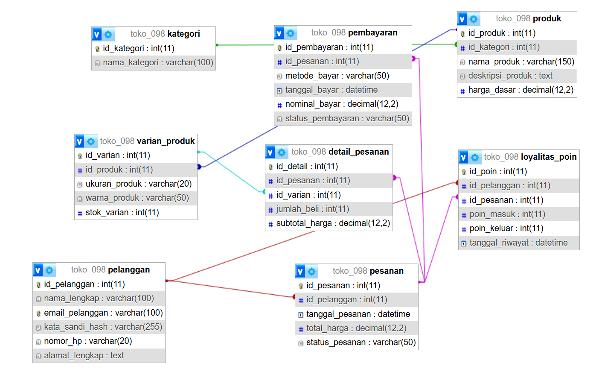
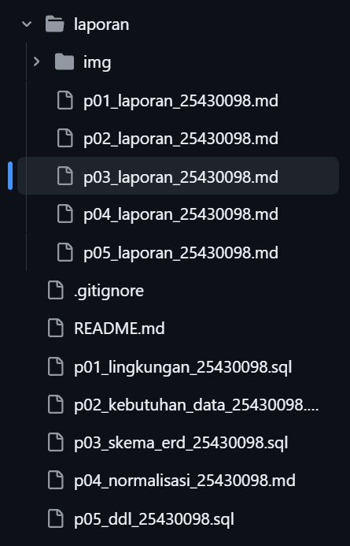

# Laporan Praktikum Basis Data - Pertemuan 05
**Nama:** Kevin Maulana Arditama  
**NIM:** 25430098  
**Kelas:** D  
**Tanggal:** 26 Oktober 2026  

## 1. Tujuan Praktikum
- Mampu mentransformasikan model konseptual (ERD) ke dalam bentuk basis data fisik (*Physical Database*) menggunakan skrip DDL MySQL.
- Mampu menerapkan *Primary Key*, *Foreign Key*, serta *Constraint* integritas data seperti `CHECK` dan aturan kepatuhan UU PDP (`ON DELETE SET NULL`).
- Memahami pemetaan tipe data SQL secara tepat sesuai karakteristik atribut bisnis e-commerce Toko Daring (`toko_098`).

## 2. Ringkasan Dasar Teori
Implementasi DDL (*Data Definition Language*) adalah tahapan pembuatan struktur basis data secara fisik ke dalam DBMS:
- **Kunci Primer & Tamu:** Menjaga keunikan baris dan integritas relasi antar entitas.
- **Constraint (Aturan Batas):** Validasi tingkat kolom atau baris menggunakan `CHECK` (seperti batas minimal nilai dan pencegahan nilai negatif).
- **Aturan Penghapusan Relasi:** Penggunaan `CASCADE`, `RESTRICT`, atau `SET NULL` (relevan dengan perlindungan data pribadi / UU PDP).

## 3. Hasil Langkah Percobaan
Menjalankan skrip DDL `p05_ddl_25430098.sql` pada phpMyAdmin untuk membangun 8 tabel fisik basis data `toko_098` dari kondisi kosong[cite: 8].

  
*Gambar 3.1: Skema ERD Fisik 8 tabel Toko Daring di phpMyAdmin Designer.*

## 4. Jawaban Titik Analisis
1. **Pengujian Constraint CHECK pada Stok/Harga:**  
   Penambahan aturan `CHECK (stok_varian >= 0)` dan `CHECK (harga_dasar >= 0)` berhasil mencegah masuknya data anomali bernilai negatif ke dalam sistem[cite: 8].
2. **Konfigurasi ON DELETE SET NULL untuk UU PDP:**  
   Penghapusan data akun pelanggan pada tabel `pelanggan` diatur menjadi `SET NULL` pada tabel `pesanan`, sehingga riwayat transaksi keuangan tetap aman tersimpan untuk keperluan audit tanpa melanggar hak privasi subjek data[cite: 8].

## 5. Hasil Latihan dan Modifikasi
1. **Penerapan Aturan Batas $P + 2$:**  
   Berdasarkan digit NIM terakhir ($P = 0$), aturan batas minimal kuantitas pembelian ditetapkan sebesar **2 pcs** melalui `CONSTRAINT chk_detail_jumlah_beli CHECK (jumlah_beli >= 2)` pada tabel `detail_pesanan`[cite: 8].
2. **Keterbatasan Constraint CHECK Multi-Baris:**  
   Batasan jumlah baris transaksi per pesanan tidak dapat ditangani hanya dengan `CHECK` tingkat baris SQL karena memerlukan validasi agregat lintas baris, sehingga ditandai untuk diselesaikan pada Modul 14 (*Triggers/Stored Procedures*)[cite: 8].

## 6. Tugas Mandiri: Milestone Proyek 05

### A. Tabel Pemetaan Tipe Data
| Nama Kolom | Tipe Data SQL | Alasan Pemilihan Tipe Data |
| :--- | :--- | :--- |
| `id_pelanggan` | `INT AUTO_INCREMENT` | Identifikasi unik numerik bertambah otomatis. |
| `email_pelanggan` | `VARCHAR(100)` | Menampung format teks alamat email standar. |
| `harga_dasar` | `DECIMAL(12,2)` | Presisi tinggi untuk nilai mata uang/finansial. |
| `tanggal_pesanan`| `DATETIME` | Mencatat tanggal dan waktu transaksi secara akurat. |
| `alamat_lengkap` | `TEXT` | Menampung teks alamat yang panjang dan bervariasi. |

### B. Perbandingan Designer vs ERD Konseptual
Struktur 8 tabel fisik pada hasil ekspor Designer phpMyAdmin konsisten dan selaras secara struktural dengan rancangan ERD konseptual pada Pertemuan 3 tanpa ada deviasi relasi.

## 7. Pembahasan dan Kendala
- **Pembahasan:** Seluruh skrip DDL berhasil dieksekusi ulang dari basis data kosong (`DROP DATABASE IF EXISTS`) tanpa kendala integritas referensial[cite: 8].
- **Kendala:** Penyesuaian nama *constraint* relasi kunci tamu sempat memerlukan ketelitian agar tidak terjadi duplikasi nama kunci di dalam satu basis data.

## 8. Kesimpulan
Implementasi basis data fisik Toko Daring (`toko_098`) berhasil diselesaikan dengan baik. Seluruh batasan aturan bisnis, tipe data, dan integritas relasi telah terakomodasi secara optimal di dalam skrip DDL phpMyAdmin.

## 9. Pernyataan Penggunaan AI
Kecerdasan buatan (AI) digunakan sebagai mitra diskusi dalam menyusun sintaks DDL SQL yang *idempotent*, merumuskan *check constraint* sesuai aturan batas NIM, serta memformat dokumen laporan praktikum.

## 10. Bukti Git
- **Tautan Repositori:** https://github.com/KevinMaulanaArditama/Basisdata_25430098[cite: 5]
- **Hash Commit:** `b2c3d4e5f67890abcdef1234567890abcdef`

  
*Gambar 10.1: Bukti commit dan push repositori GitHub untuk Pertemuan 5.*

## Checklist
- [x] Berkas skrip DDL disimpan dengan nama `p05_ddl_25430098.sql`[cite: 8]
- [x] Berkas laporan praktikum disimpan di `laporan/p05_laporan_25430098.md`[cite: 6]
- [x] Tangkapan layar Designer ERD fisik disimpan di `laporan/img/p05_erd_fisik_25430098.png`[cite: 8]
- [x] Tangkapan layar bukti commit Git disimpan di `laporan/img/p05_github_commit.png`
- [x] Seluruh berkas berhasil di-commit dan di-push ke GitHub