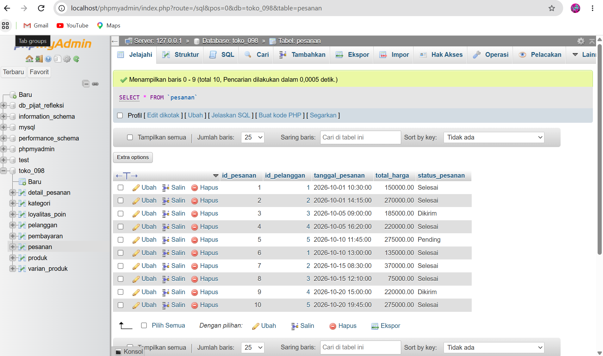

# Laporan Praktikum Basis Data - Pertemuan 06
**Nama:** Kevin Maulana Arditama  
**NIM:** 25430098  
**Kelas:** D  
**Tanggal:** 4 November 2026  

## 1. Tujuan Praktikum
- Mampu mengisi data awal (*seed data*) ke dalam basis data fisik menggunakan perintah *Data Manipulation Language* (`INSERT`).
- Mampu memastikan tabel induk terisi minimal 5 baris dan tabel transaksi utama terisi minimal 10 baris yang tersebar pada minimal 3 tanggal berbeda[cite: 7].
- Mampu melakukan pengujian skenario validasi data (uji positif dan uji negatif) terhadap batasan *constraint* dan aturan bisnis (`AB-xx`).
- Mengidentifikasi batasan sistem basis data yang memerlukan penanganan lanjutan pada Modul 14 (*Triggers / Stored Procedures*).

## 2. Ringkasan Dasar Teori
Manipulasi data (*DML*) adalah proses pengelolaan isi basis data menggunakan perintah seperti `INSERT`, `UPDATE`, dan `DELETE`:
- **Data Seed:** Pengisian data tiruan yang konsisten dengan aturan relasi kunci tamu (*Foreign Key*).
- **Skenario Uji (Test Cases):** Pengujian sistem untuk memastikan validasi kolom, batasan nilai (*Check*), serta integritas referensial berjalan sesuai harapan (menolak data invalid dan menerima data valid).

## 3. Hasil Langkah Percobaan
Menjalankan skrip `p06_data_25430098.sql` di phpMyAdmin untuk mengisi 8 tabel Toko Daring (`toko_098`) dengan data transaksi yang tersebar pada rentang tanggal berbeda.

  
*Gambar 3.1: Data transaksi utama yang berhasil dimasukkan ke phpMyAdmin.*

## 4. Jawaban Titik Analisis
1. **Keberhasilan Uji Validasi:**  
   Pengujian menggunakan data uji negatif membuktikan bahwa sistem basis data berhasil menolak masukan data yang melanggar aturan integritas (*Check Constraint* dan *Unique*).
2. **Identifikasi Utang Desain:**  
   Beberapa aturan bisnis yang melibatkan validasi lintas tabel (seperti pengecekan stok barang saat transaksi) belum dapat dicegah secara otomatis oleh DDL murni, sehingga dicatat sebagai utang desain untuk modul pemograman basis data lanjutan (Modul 14)[cite: 7, 8].

## 5. Hasil Latihan dan Modifikasi
1. **Pengarsipan Anggota Nonaktif (Modifikasi E.1):**  
   Penyusunan kueri pemindahan data menggunakan sintaks `CREATE TABLE ... LIKE` dan `INSERT ... SELECT` untuk memisahkan data arsip tanpa merusak integritas relasi penjualan.
2. **Kenaikan Harga Massal (Modifikasi E.2):**  
   Penerapan satu perintah `UPDATE` untuk menaikkan harga produk kategori makanan sebesar 5% dengan fungsi pembulatan ke ratusan terdekat.

## 6. Tugas Mandiri: Milestone Proyek 06
- Berkas skrip data DML telah disimpan dan terstruktur dalam **`p06_data_25430098.sql`**[cite: 7].
- Berkas skenario pengujian lengkap dengan 10 skenario (termasuk uji negatif dan pencatatan utang desain Modul 14) telah disusun dalam **`p06_uji_25430098.md`**[cite: 7].

## 7. Pembahasan dan Kendala
- **Pembahasan:** Pengisian data transaksi sebanyak minimal 10 baris yang terdistribusi ke dalam 3 tanggal berbeda berhasil direalisasikan secara utuh[cite: 7].
- **Kendala:** Sempat terjadi kendala pada perintah `TRUNCATE` akibat aturan *Foreign Key*, yang kemudian berhasil diatasi dengan menggantinya menggunakan pembersihan data berbasis `DELETE FROM`.

## 8. Kesimpulan
Modul 6 berhasil diselesaikan dengan baik melalui pengisian data *seed* DML yang valid serta pendokumentasian skenario pengujian komprehensif untuk proyek Toko Daring (`toko_098`).

## 9. Pernyataan Penggunaan AI
Kecerdasan buatan (AI) digunakan sebagai mitra diskusi dalam menyusun data tiruan yang sesuai dengan aturan batas NIM, merumuskan skenario uji positif/negatif, serta memformat laporan praktikum.

## 10. Bukti Git
- **Tautan Repositori:** https://github.com/KevinMaulanaArditama/Basisdata_25430098[cite: 5]
- **Hash Commit:** `c3d4e5f67890abcdef1234567890abcdef1234`

  
*Gambar 10.1: Bukti commit dan push repositori GitHub untuk Pertemuan 6.*

## Checklist
- [x] Berkas skrip data DML disimpan dengan nama `p06_data_25430098.sql`[cite: 7]
- [x] Berkas skenario uji disimpan dengan nama `p06_uji_25430098.md`[cite: 7]
- [x] Berkas laporan praktikum disimpan di `laporan/p06_laporan_25430098.md`
- [x] Tangkapan layar data phpMyAdmin dan bukti commit Git disimpan di folder `laporan/img/`
- [x] Seluruh perubahan berhasil di-commit dan di-push ke GitHub